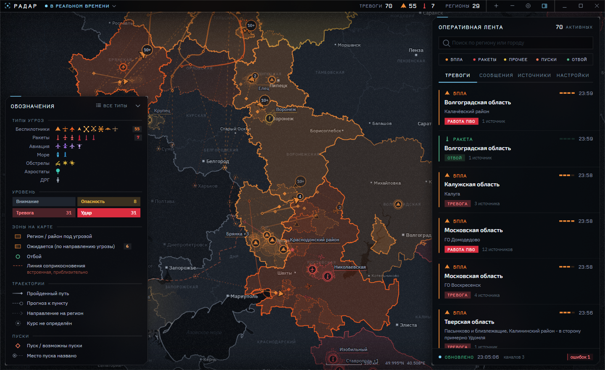
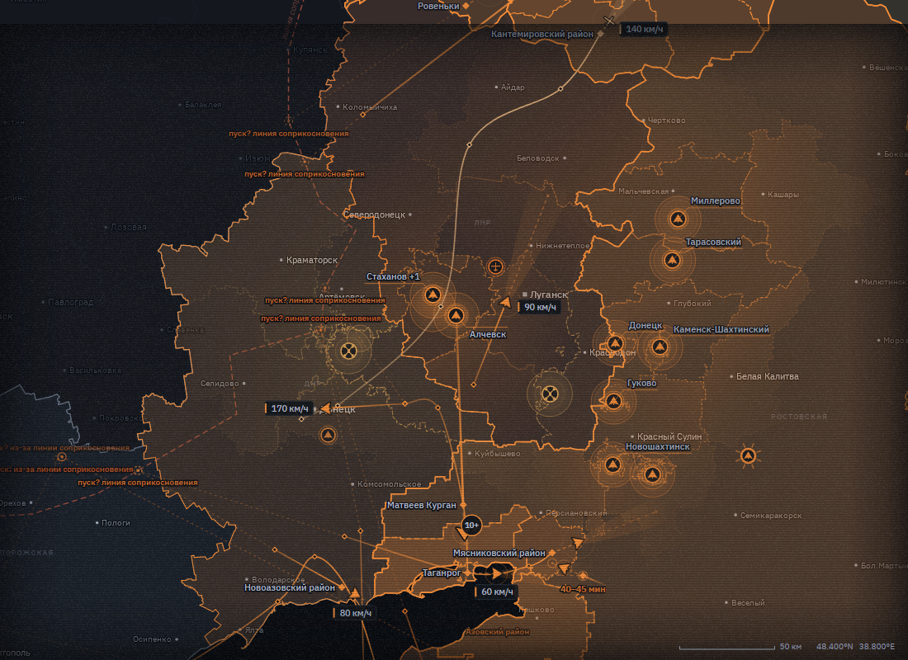
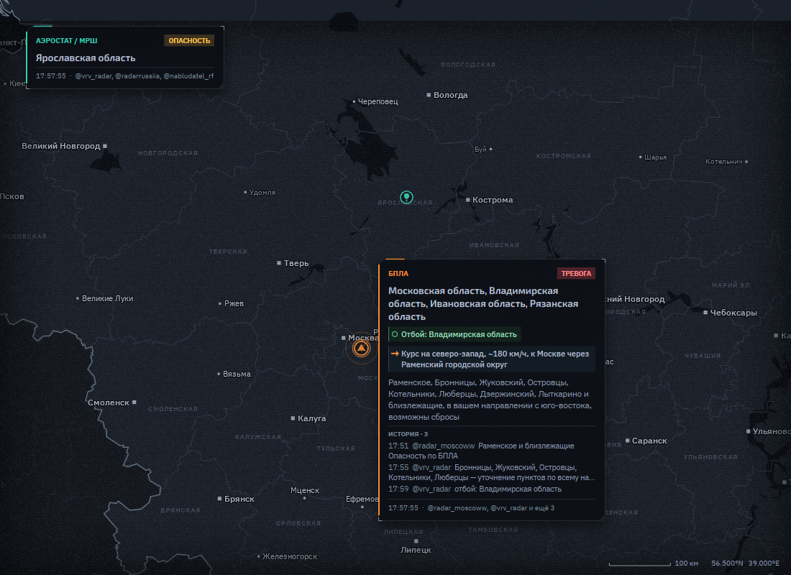
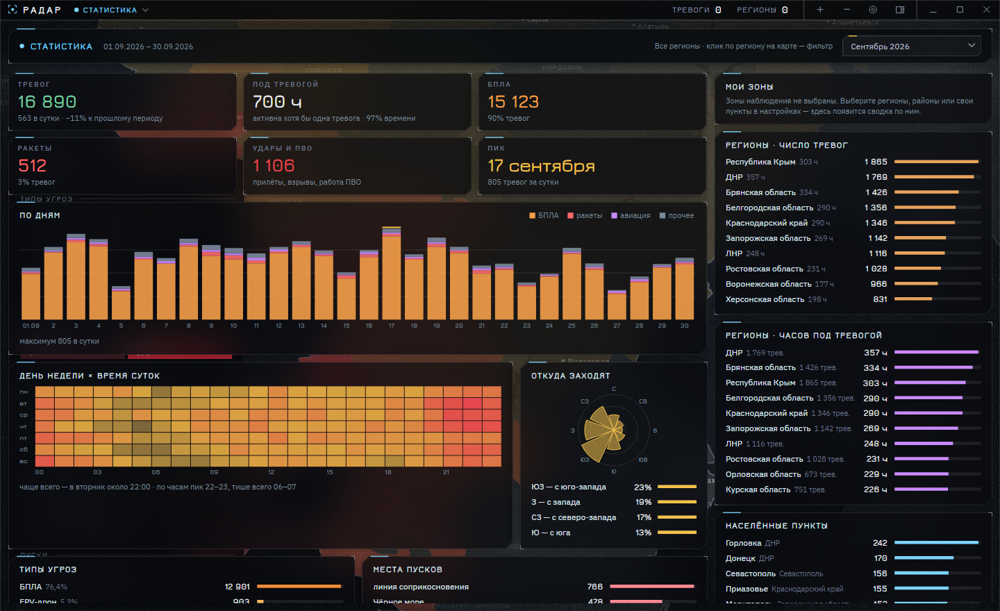

# Радар

Карта воздушных тревог по сообщениям публичных Telegram-каналов (веб-превью t.me/s): БПЛА, ракеты, авиация, аэростаты
и др. Сообщения разбираются в тревоги по регионам и пунктам, отметки одного объекта складываются в треки с оценкой
скорости и прогнозом пути. Windows, Linux и Android (C#/.NET 10, Avalonia).

## Установка

Последняя сборка — на странице [релизов](https://github.com/Escorp-Dynamics/radar/releases/latest):
`Radar-*-win-x64.zip` (Windows), `Radar-*-linux-x64.tar.gz` (Linux), `Radar-*.apk` (Android 8.0+).
Приложение само проверяет обновления при запуске (вкладка «Настройки» → «О программе») и загружает архив сообщений
для истории и статистики — только новые и изменившиеся месяцы.

Вопросы, предложения и замечания — [в Telegram](https://t.me/escorplab?direct).

### Поддержать разработку

<!-- виджет ЮMoney: GitHub вырезает iframe, на других площадках (сайт, документация) он покажется как есть -->
<iframe src="https://yoomoney.ru/quickpay/fundraise/button?billNumber=1KNOTETVTB3.261005&" width="330" height="50" frameborder="0" allowtransparency="true" scrolling="no"></iframe>

## Сборка

    dotnet run --project Radar                                     # настольная версия
    dotnet test --project Radar.Tests
    dotnet publish Radar/Radar.csproj -c Release -r linux-x64 -o out   # NativeAOT
    dotnet build Radar.Android -t:Install                          # Android (нужен workload android)

Структура: `Radar.Core` — общая часть (движок, карта, интерфейс), `Radar` — настольная оболочка (трей, автозапуск,
утилиты архива), `Radar.Android` — Android (фоновая служба, уведомления), `Radar.Tests` — тесты,
`tools/` — скрипты аудита, `tools/assets/` — сборка встроенных данных карты (`Radar.Core/Assets`).

Данные (настройки `settings.json`, кеш сообщений, кеш геокодера `geocode.tsv`, линия соприкосновения, архив
`archive-pack`) — в каталоге `Radar` внутри локальных данных пользователя (на Linux `~/.local/share/Radar`). Формат
архива и утилиты для него описаны в [artifacts/README.md](artifacts/README.md).

## Автоматизация

- **release** — каждый пуш в `main`: тесты, сборки NativeAOT под Linux и Windows, APK (AOT, подпись ключом из
  секретов `ANDROID_KEYSTORE_B64` / `ANDROID_KEYSTORE_PASS`) и релиз `vX.Y.N` (`X.Y` — `RadarVersionBase` в
  `Directory.Build.props`, `N` — номер сборки).
- **archive** — ежедневно: прежний архив из релиза `archive` распаковывается, докачиваются новые сообщения каналов,
  упаковывается и проверяется; загружаются изменившиеся месяцы, манифест — последним.

## Тревоги и карточки

Сообщение даёт тревогу: тип угрозы, уровень (внимание / опасность / тревога), регионы и пункты. Повторы того же
сообщения в других каналах присоединяются к той же тревоге как источники. Отбой снимает тревоги по названным
пунктам, по региону целиком или по части области; регион, в котором отбой не называет пунктов («Отбой … Приазовье ⏎
Крым и Севастополь»), снимается целиком.

Отбой снимает тревоги только своей группы угроз (`ThreatCatalog`): названия в сообщениях относятся к группам так —

| В тексте | Группа | Отбой снимает |
|---|---|---|
| БПЛА, «Шахед»/«Герань», реактивные БПЛА, «Хорнет», ФПВ, «Баба-яга» | БПЛА | тревоги по БПЛА |
| «Шторм» (Storm Shadow), SCALP, «Таурус», **«Фламинго»** — крылатые ракеты, хотя каналы пишут «БПЛА Фламинго» | ракеты | ракетные и авиационные |
| «Нептун», ПКР — противокорабельные; баллистика, ATACMS, «Искандер»; HIMARS | ракеты | ракетные и авиационные |
| УАБ, КАБ, авиабомбы; самолёты, «носители» | авиация | ракетные и авиационные |
| аэростаты, МРШ/МВШ | аэростаты | аэростаты |
| БЭК, катера, морские дроны | флот | флот |

Каналы иногда дописывают новое в уже опубликованный пост: отбой («Опасность по БПЛА ⏎ UPD: Отбой»), сбитие или
прилёт («UPD: сбит», «UPD: есть прилёт»), направление («UPD: в сторону Подгорного»). Приложение следит за правками
постов последних 6 часов и применяет дописанное сразу, по местам и угрозе исходного поста (в ленте — ссылка на тот же
пост). Не применяются: опровержения («не подтверждено», «ошибочная»), пересказы («кто-то утверждает»), подписи
каналов, исправление пунктов без новой информации, правки поста, где отбой уже был, и правки итоговых сводок
(МО, «за прошедшую ночь») и постов-опровержений («прилётов не зафиксировано», «не ведитесь на провокации»).

Совмещённый отбой «отбой ракетной опасности и (опасности) БПЛА» или «отбой ракетной, отбой БПЛА» снимает обе
группы; «отбой ракетной опасности … БПЛА сохраняется» — только ракетную; «Ракетная опасность ⏎ Отбой по БПЛА» —
только БПЛА. Отбой без типа («Отбой», «отбой опасности») снимает любые.

Всплывающая карточка тревоги на карте: полоса цвета угрозы, заголовок, плашки уровня, движения и отбоя, длинные строки
переносятся. Текст карточки, ленты и системного уведомления — краткая выжимка сообщения (`AlertSummary`): из него
убрано то, что уже показано заголовком и плашками — регион, уровень, тип угрозы (если совпадает с группой тревоги),
дежурные фразы и подписи каналов, в отбоях — «отбой…», «режим внимания», время. «Фиксация/сбитие БПЛА» сводится к
количеству («от 3 шт», «группа»). Источники — «@канал, @канал и ещё N».

## Треки

Трек — последовательные отметки одного объекта (`TrackBuilder`). Отметка присоединяется к треку, если объект
физически мог в неё попасть (по типовой или измеренной скорости), курс согласован с путём, с заявленной целью и с
курсом из сообщения. Основные правила, проверенные на полном архиве:

- **Не назад к линии.** БПЛА и ракеты, пересёкшие линию соприкосновения, к ней не возвращаются: отметка, уводящая трек
  назад (от самой глубокой точки пути или от места захода), — другой объект. На суше — к линии, в Крыму и на Кубани —
  обратно к месту захода с моря.
- **Короткий трек.** У трека из 1–2 отметок курс ещё не подтверждён: отметка ближе к линии, чем его начало, — другая
  группа (Калуга → Бабынинский район), если её не объясняет курс или цель из сообщения в ту же сторону либо подлёт
  к крупному городу у линии (Белгород).
- **Курс и цель из сообщения.** «Далее на Воронеж», «в сторону Брянска», «на северо-восток» задают курс; отметка
  против этого курса — встречная группа. Старые (30+ мин) цель и курс, расходящиеся с путём, сбрасываются.
- **Подтверждения.** «Опасность сохраняется» без засечки подтверждает трек на месте, но не продлевает его к линии.
- **Сводки по районам.** «Кимовский ⏎ Воловский ⏎ Щекинский … фиксации» — несколько групп, а не один объект: каждый
  район продолжает уже идущий трек, если лежит по его курсу рядом с расчётным положением, но новых треков не начинает
  (иначе отметки разных сводок склеиваются в маршруты, которых в сообщениях нет). В Крыму и на Кубани не применяется.
- **ФПВ и тактические БПЛА** летят от линии и не наследуют путь дальнего БПЛА рядом с ней.
- **Отделение группы.** Новая группа у существующего трека наследует его общий путь, если это не даёт петли или
  возврата к линии.

На карте трек — линия отметок, значок с направлением и скоростью (измеренной — после достаточного интервала между
отметками). Прогноз — пунктир к цели или по курсу, с учётом дорог, коридоров и названных промежуточных пунктов;
назад к линии пуска он не рисуется. Трек из двух отметок, идущий к линии без цели, курса и прогноза, — скорее шум
привязки (центры соседних районов): линия между отметками не рисуется, значок — без направления и скорости, вокруг
последней отметки — пунктирная зона неточности (`Track.UncertainHeading`). Исключение — вторая отметка в самом
крупном городе (он и есть вероятная цель).

Снимки для README: `Radar --render-demo файл.png` с `RADAR_DEMO_CORPUS=<архив.json>` и `RADAR_DEMO_VIEW=широта,долгота,масштаб`
(обстановка на момент последнего сообщения), карточки — с `RADAR_DEMO_TIP=1`. Окно целиком — `Radar --render-ui файл.png`
с тем же `RADAR_DEMO_CORPUS`, `RADAR_UI_FEED=1` (лента и каналы), `RADAR_UI_FREEZE=1` (время архива) и
`RADAR_UI_CENTER=широта,долгота,масштаб`; карточка — `RADAR_UI_HOVER=<пункт>` (наведение на его отметку), без боковой
панели — `RADAR_UI_HIDE_SIDEBAR=1`.

Качество треков и прогнозов проверяется прогоном всего архива (`tools/run_audit.sh`, таблица
`artifacts/validation/engine-audit-months.tsv`): развороты, петли, треки и прогнозы к линии, отбои — все метрики
качества нулевые.

## Производительность и надёжность

- Карта рисуется на процессоре (≈3 % ядра на кадр), поэтому полная частота — только во время анимаций (появление и
  угасание тревог, движение камеры, нарастание обрыва связи). Фоновая анимация (пульсация, бегущие пунктиры, помехи)
  — по настройке «Плавность анимации»: экономно 8 кадров/с, обычно 15, плавно 30 (в неактивном окне — вдвое реже,
  в свёрнутом ничего не рисуется). Стекло панелей размывает уменьшенную в 8 раз копию карты и держит её до 0,25 с,
  пока карта под панелью не сдвинулась и данные не поменялись; тени панелей рисуются один раз на размер. На X11
  включён удерживаемый буфер кадра (без него буфер окна выделялся заново на каждый кадр — сотни сборок мусора в
  минуту). В простое с обстановкой на карте: экономно ≈32 % ядра, обычно ≈36 %, плавно ≈58 % (раньше ≈110 %).
  Замер: `RADAR_IDLE_CORPUS=<архив.json> Radar` — окно с обстановкой из архива, без опроса и звука.
- Перетаскивание карты — не чаще 30 кадров/с («плавно» — 60), ретро-помехи на время жеста и масштабирования не
  рисуются. При отдалении подложка заранее рисуется в фоне сразу для конечного масштаба (без синхронных перерисовок
  в потоке интерфейса); фоновая перерисовка идёт одной полосой — общая работа процессора меньше, чем в параллельных
  полосах. Подложка и кэш зон выводятся как непрозрачные растры (копированием, без смешивания). Во время жеста подложка
  рисуется в половинном разрешении (вчетверо меньше пикселей), чёткая — через 0,12 с после остановки.
- Лента обновляется на месте: снимок треков берётся один раз на обновление, порядок карточек проверяется без поиска
  по всей ленте, счётчики заголовка уведомляют только при изменении.
- Настройки при переключателях пишутся в фоне с задержкой 0,4 с (при выходе — сразу), атомарно; значения из файла,
  испорченного вручную, приводятся к допустимым (пустые поля зон, порог уведомлений, радиусы 3–100 км). Если файл
  при запуске занят (антивирус, второй экземпляр), сеанс работает на значениях по умолчанию и рабочий файл не
  перезаписывает. Новый интервал опроса применяется сразу: текущие паузы каналов прерываются (паузы после ошибок и
  ограничения частоты — нет).
- Опрос каналов соблюдает паузу, которую Telegram требует при ограничении частоты (`Retry-After`). Пропуск между
  опросами догружается целиком, иначе повторяется: оборванная догрузка не сдвигает отметку последнего прочитанного поста.
- Ошибка в одном сообщении не останавливает обработку: пачка повторяется по одному сообщению.
- Доступ к Telegram без VPN (настройки → «Доступ к Telegram»: авто / прокси / напрямую). В режиме «авто» ленты
  читаются напрямую, а если t.me не отвечает или отдаёт заглушку (и это подтверждает эталонный канал) — через
  бесплатные прокси: ротатор [Escorp.Atom.Web.Services.Proxies](https://www.nuget.org/packages/Escorp.Atom.Web.Services.Proxies)
  собирает открытые списки, кандидаты проверяются запросом к настоящей ленте канала, до 6 рабочих чередуются между
  каналами, отказавшие выбывают, найденные сохраняются до следующего запуска. Прямой путь перепроверяется раз в 10 минут.
  Обновления и архив с GitHub при сетевом сбое тоже повторяются через этот пул.

## Уведомления и звук

- Системное уведомление и звук — о новой тревоге или повышении уровня, если она проходит фильтры типов и уровней,
  порог уведомлений и выбранные зоны (строка поиска ленты на уведомления не влияет). «Приближается» — только для уже
  объявленной тревоги, повернувшей к своему пункту. Тревоги, пришедшие, пока открыта история или статистика,
  объявляются при возврате в реальное время; потеря и восстановление связи — в любом режиме.
- Пачка уведомлений схлопывается: в течение 2 с после показанного следующие копятся и показываются сводкой «Ещё
  оповещений: N» (одно — своим текстом).
- Звуки — мягкие ноты среднего регистра, не громче трети шкалы. Сигналы тревог — не чаще раза в 8 с (срочный — через
  3 с после обычного), сигналы связи ограничиваются отдельно; проба громкости и «Проверить» ограничение не сдвигают.
  В демо-режиме (`RADAR_DEMO=1`) и замере (`RADAR_IDLE_CORPUS`) — ни звука, ни уведомлений.

## Статистика

Режим «Статистика» прогоняет архив месяц за месяцем тем же движком, что и в реальном времени (тревога — событие
после склейки репостов, длительность — до отбоя или истечения); итоги месяцев кешируются в `{архив}/.stats/`. Кеш
привязан к архиву (SHA-256 пакетов месяца и соседних) и к коду разбора и движка: после их изменения месяцы
пересчитываются, а пока идёт пересчёт, показываются прежние итоги. Готовые итоги всех месяцев считает workflow
`archive` и выкладывает в релиз `archive` — приложение берёт их вместо прогона движка на устройстве. Тревога относится к месяцу по началу; её отбой и репосты учитываются и после конца месяца (6 ч).

- Периоды — по местному времени: месяц с 00:00 1-го числа, «последние 7/30 дней» — полные сутки до последнего
  сообщения архива. Сравнение «к прошлому периоду»: месяц — с предыдущим месяцем в пересчёте на сутки, остальное — с
  окном той же длины; без полного прошлого периода в архиве сравнение не показывается.
- Пункты в рейтинге — со своим регионом; фильтр по региону действует на тревоги, дни, неделю×час, пункты и
  направления захода (по контуру региона в точке окончания трека). Тепловая раскраска карты — всегда по всем регионам.

